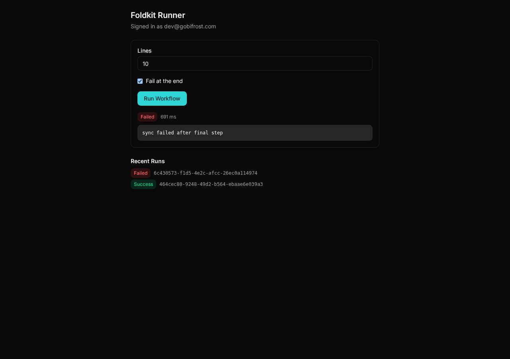

# Foldkit Spike: Bifrost Apps

This explores whether customer and agent-authored Bifrost **Apps** (independent V2 Apps and Solution-owned Apps) can use Foldkit instead of, or alongside, React. Dated 2026-11-18; fork-only. It follows the control-plane spikes ([execution logs](foldkit-execution-logs.md), [design system](foldkit-design-system-port.md)).

**Short answer:**

- A Foldkit App runs on today's platform. The host's `mount-v1` contract, the server build, storage, and delivery are framework-neutral. A Foldkit App deployed through the normal `bifrost app deploy` pipeline mounts, authenticates, runs workflows, and tears down correctly.
- Two platform defects block doing this properly, both fixable without touching React Apps:
  1. The injected SDK package's required React peers break locked builds.
  2. Every App is stamped as an SDK binding consumer, so the host preloads the 166 kB gzip React SDK factory even for Apps that never use it.
- Beyond those, the cost is the React-only SDK surface, header, scaffold, and agent guidance.

**Recommendation:** pursue option B. Extract a framework-neutral SDK core with React and Foldkit adapters, and offer Foldkit as an *additional* App framework. Do not replace React for Apps: existing customer Apps, Solutions, and the V1 runtime are React by contract.

## Proof of Concept

[`examples/foldkit-runner`](../../examples/foldkit-runner) is a Foldkit App created with `bifrost app create`, with the React sources replaced:

| File | Lines | Role |
|---|---|---|
| `src/main.ts` | 52 | `mount(mountEl, bootstrap)` → `Runtime.embed`, returns teardown; registers in `__BIFROST_APP_MODULES__`; keeps the scaffold's dev bootstrap |
| `src/bifrost.ts` | 122 | Effect client for the App wire contract: bearer token (via the host's `__BIFROST_PLATFORM_AUTH_V1__` refresh bridge), `X-Bifrost-Org`, `X-Bifrost-App`; current user; start workflow; fetch execution |
| `src/app.ts` | 350 | Foldkit program: run form, status, result or error, run history. Execution polling is a Model-gated Subscription that the runtime stops when the run settles. |

Non-blank, non-comment lines.

The scaffold's `vite.config.ts` (dev credentials), `index.html` (`mount-v1` marker), and `index.css` (Bifrost tokens) were kept. Only the plugin list changed, from `react()` to `foldkit()`, the full plugin, since the App owns its whole module graph.

**Verified on the per-worktree debug stack, in Chromium:**

- `bifrost app deploy` built and deployed it as an ordinary `standalone_v2` App (server-side `npm install` + `vite build`).
- The host mounted it at `/apps/foldkit-runner` in the Bifrost theme. It read the signed-in user.
- A run went Starting → Pending → Running → Success with the workflow's result. A failing run showed the workflow's error. Client-side validation worked.
- Both workflow requests carried `X-Bifrost-App`, so they are scoped to the install exactly as the React SDK's are.
- Leaving the route tore the App down; returning remounted it with fresh state.
- There were no console errors after login.



### Bundle

| | App bundle (gzip) | Hosted SDK factory (gzip) |
|---|---|---|
| React scaffold, untouched template | 56 kB | 166 kB, loaded at runtime and shared across Apps |
| Foldkit Runner | 104 kB | 166 kB, **loaded although unused** (defect 2) |

The Foldkit App carries Effect and Foldkit itself. The React App's bundle is small because the SDK implementation arrives through the hosted factory, which is content-addressed and cached across Apps.

## Defects Found

### 1. The SDK's React peers break locked non-React builds (blocker)

The server merges `"bifrost": "file:./bifrost-sdk.tgz"` into every App's `package.json` (`api/src/services/solutions/app_build.py:_materialize`). That package declares `peerDependencies: { react: ">=18", "react-dom": ">=18" }` (`api/src/services/sdk_package/__init__.py`).

For a locked build, `refresh_sdk_lockfile` (`api/bifrost/app_lockfile.py`) grafts only the SDK's own lock entry into the App's lockfile. npm would auto-install the React peers, but they are not in the lock, so `npm ci` fails:

```
npm error Missing: react@19.3.1 from lock file
npm error Missing: react-dom@19.3.1 from lock file
npm error Missing: scheduler@0.28.0 from lock file
```

This was reproduced both through `bifrost app deploy` and with a local simulation of the graft. Unlocked builds succeed, installing React unused, which is why the PoC ships without a lockfile.

That workaround does not survive SDK updates. Automatic SDK-update rebuilds require a lockfile (`api/src/services/application_build.py:81`, `require_lockfile=True`). A lockless Foldkit App fails them with "Locked builds require package-lock.json"; one with a lockfile fails on the React peers. **Today a non-React App cannot receive automatic SDK updates either way.**

**Fix options:**

- Mark the peers optional (`peerDependenciesMeta: { react: { optional: true }, "react-dom": { optional: true } }`). npm then stops auto-installing them, and React Apps are unaffected because they depend on React directly.
- Alternatively, inject the SDK only into Apps that import it.

### 2. Every App is stamped as an SDK binding consumer

The deployed App record carries `sdk_binding_api_major: 1` and `sdk_package_version: 1.4.1`, because the stamp comes from the injected tarball rather than from the App's imports. The host therefore fetches `/api/app-sdk/v1/manifest` and the 905 kB (166 kB gzip) hosted factory before mounting.

**Fix:** stamp the binding only when the built graph imports `bifrost`, or let the App declare that it does not use the binding. The host already skips the preload when the major is null (`client/src/components/jsx-app/StandaloneV2App.tsx`, `hostedSdkReady`). Null currently means "legacy bundled SDK", so a distinct "no binding" marker may be clearer.

### 3. Smaller gaps

- **No neutral SDK entry point.**
  - The framework-neutral modules already exist inside the SDK: `transport.ts`, `ws-client.ts`, `execution-stream.ts`, `tables.ts`, `files.ts`, `errors.ts`, `branding-theme.ts`.
  - They are only reachable through `index.v2`, which creates React context at module load, and the transport is installed by `BifrostProvider` during render.
  - Workflow execution, the current user, branding, and organizations are hook-only.
  - The PoC therefore reimplements about 120 lines of the wire contract. That duplicates retry, refresh, and WebSocket logic that the SDK already tests.
- **`BifrostHeader` is a React component.** It takes a React-router `NavLink`. A Foldkit App has no platform header, as the screenshot shows.
- **Shared document.** Apps are mounted in the host document, not an iframe, so App CSS is global. This is the same for React Apps, and not Foldkit-specific.
- **Authoring surface.** The scaffold, CLI, and agent guidance are React throughout:
  - `bifrost app create` generates React 18 / Vite 5.
  - `.claude/skills/bifrost-build/references/apps-v2.md` opens with "A V2 App is a normal React/TypeScript/Vite project".
  - The Apps best-practices guide prescribes React Router and hooks.

## Options

| Option | What it means | Effort | Risk |
|---|---|---|---|
| **A. Foldkit Apps on today's platform** | Fix defects 1 and 2; Apps own their client code, as the PoC does | Small: two targeted platform changes | Each Foldkit App reimplements the wire contract; no header; no shared fixes |
| **B. Neutral SDK core + adapters** (recommended) | Export the existing neutral modules as `bifrost/core` (`createClient(bootstrap)`, `tables`, `files`, `workflows.run/subscribe`, `me`, `branding`); rebuild the React hooks on it; add a Foldkit adapter (Commands, Subscriptions, Effect services); ship a DOM header; add a `--framework foldkit` scaffold and parallel agent guidance | Medium: SDK restructure behind the existing React surface, plus a new adapter, scaffold, and docs | Must keep the hosted-binding contract and `sdk-contract.json` stable for every deployed React App; the architecture doc previously rejected a React-free protocol runtime, so this needs a recorded decision |
| **C. Replace React for Apps** | Migrate scaffold, SDK, V1 runtime, existing customer Apps, and Solutions | Large | Breaks every customer and Solution App, the V1 inline runtime, and the 270-name V1 platform surface; customer code is outside Bifrost's control |

Option C is not viable. Customer Apps and Solutions are authored against React, and the platform cannot migrate code it does not own.

Option B delivers the agent-authoring benefits where agents write the most code. The program shape is explicit, and the Model and Message history can be inspected through the DevTools MCP during `bifrost app start`. It does this without breaking the React surface.

## Suggested Sequence

1. **Fix defects 1 and 2.** These are small platform changes, valuable even for React-free utility Apps. Each needs a fork PR with a regression test (an e2e locked deploy of a non-React App; a binding-stamp unit test).
2. **Extract `bifrost/core`.** Move transport installation out of render into `createClient(bootstrap)`; export `workflows.run/subscribe` from the existing `use-workflow.ts` and `execution-stream.ts` logic; make `BifrostProvider` and the hooks consumers of the core. The React hook tests and the wire contract tests must stay unchanged. Read [`server-provided-app-runtime.md`](../architecture/server-provided-app-runtime.md) first. Changing the hosted factory's React peer ABI needs its own decision.
3. **Write the Foldkit adapter and a framework-neutral header.** Port the PoC to `bifrost/core` and delete its private client.
4. **Add a `bifrost app create --framework foldkit` scaffold**, Foldkit sections in the bifrost-build skill, and vendored Foldkit sources for agents.
5. **Gate on the [adoption gates](foldkit-adoption-gates.md):** an e2e happy path for a Foldkit App in `client/e2e`, bundle budgets per App, and agent-iteration measurements on a real App task.

## Reproducing

The PoC source and deploy steps are in `examples/foldkit-runner/README.md`. The test workflow is the `spike_log_stream` workflow from the [execution-logs spike](foldkit-execution-logs.md) (`workflows/spike_log_stream.py`). Register it with `bifrost files write` and `bifrost workflows register`.
