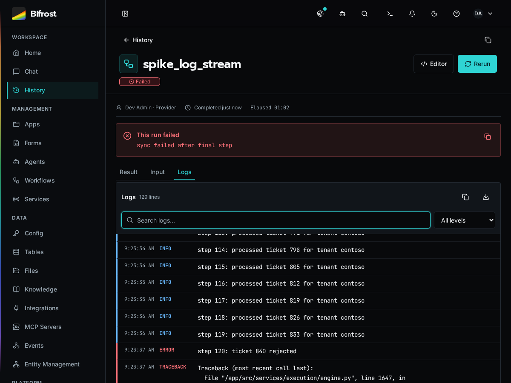

# Foldkit Spike: Execution Logs Inspector

**Recommendation: retain React for the control plane.** Do not migrate incrementally to Foldkit or adopt it selectively at this time. Foldkit's architecture delivered real benefits. However, in Bifrost's React shell the measured costs were higher: bundle size, a second UI paradigm, design-system duplication, dev-tooling conflicts, and pre-1.0 churn. The benefits can mostly be obtained inside React. The revisit conditions are at the end.

> **Follow-up:** [Design-System Port](foldkit-design-system-port.md) ports Button, Badge, Input, Dialog, DropdownMenu, and icons, and measures parity against Radix. It revises the design-system cost described below: that cost is lower than this document assumed. The remaining blockers are listed there.

Scope: fork-only evaluation spike, dated 2026-11-18. It covers Foldkit `0.171.0`, `@foldkit/ui 0.171.0`, `effect 4.1.4`, React `19.3`, and Vite `8.3`.

## What Was Built

The **Logs tab of the workflow execution inspector** was reimplemented in Foldkit and embedded in the unchanged React `ExecutionDetails` page through `Runtime.embed`. The original is `client/src/components/execution/ExecutionLogsPanel.tsx`, rendered by `client/src/pages/ExecutionDetails.tsx`.

It is a bounded, production-representative slice with:

- interaction state: search, level filter, follow/pause auto-scroll, and copy feedback timer
- asynchronous effects: clipboard, file download, a delayed reset, and DOM scrolling after commit
- live inputs: streamed and merged logs, execution status, and WebSocket connectivity
- authorization-derived input: DEBUG visibility via `canReadDiagnostics`

Ownership is split deliberately. React keeps everything that crosses the network or touches identity: React Query execution fetches, the Zustand execution-stream store, WebSocket subscription, log merge/dedup, authorization checks, and `sonner` toasts. The Foldkit runtime owns only the panel's interaction state. Backend APIs, auth, authorization, and execution semantics are untouched.

```
ExecutionDetails (React)
  ├─ useExecution / useExecutionStream / mergeLogsWithDedup / useAuthorization   ← unchanged
  └─ <FoldkitExecutionLogsPanel>  (React host adapter)
        Flags ──────────────► Runtime.embed(makeElement(...))
        hostInputsChanged ──► Port.inbound(HostInputs)  → UpdatedHostInputs
        notificationRequested ◄── Port.outbound(Notification) ← NotifyCopyFailed Command
```

| File | Role |
|---|---|
| `client/src/foldkit/executionLogs/main.ts` | Model, Messages, Ports, Commands, Mount, update, view, program |
| `client/src/foldkit/executionLogs/logs.ts` | Framework-free log domain: filter, traceback coalescing, export text, reconciliation |
| `client/src/foldkit/executionLogs/FoldkitExecutionLogsPanel.tsx` | React host adapter (embed, port bridge, dispose) |
| `client/src/foldkit/executionLogs/spikeSwitch.tsx` | Opt-in switch plus `React.lazy` boundary |
| `client/src/foldkit/ui/*` | Ported Bifrost design-system components (see the follow-up) |
| `client/src/foldkit/executionLogs/*.test.ts(x)` | Story, Scene, pure-logic, parity, and host-boundary tests |

### Try It

React remains the default. Open any execution with `?logsRenderer=foldkit`, or set `localStorage["bifrost.spike.logsRenderer"] = "foldkit"`, then select **Logs**. To record Foldkit DevTools history locally, also set `localStorage["bifrost.foldkit.devtools"] = "1"`. It only applies in Vite dev builds; see the DevTools section for why the overlay and MCP need a separate harness.

| React (default) | Foldkit (opt-in) |
|---|---|
|  |  |

Both screenshots show the same failed 120-line execution on the live debug stack. The only visible difference is the level filter: `@foldkit/ui` renders a native `<select>`, where shadcn renders a Radix listbox.

## Evidence

### Behavioural Parity

`FoldkitExecutionLogsPanel.test.tsx` runs **the same React Testing Library scenarios against both renderers** using `describe.each`. The scenarios are:

- lines, traceback coalescing, count label, and Live badge
- search with "Clear filters"
- streamed appends keeping their order
- copy success, plus copy failure surfacing as a toast
- the disconnected warning
- structured data disclosure

All pass for both renderers. Temporarily changing one Foldkit label made exactly one parity test fail, so the suite does detect drift.

Live verification used the per-worktree debug stack with real login, API, WebSocket, and worker. A scripted Chromium session ran a log-emitting workflow, once per renderer, and observed identical results: 309 lines, a search narrowing to "12 visible", one traceback block, 300 rendered rows, the Live badge while running, and jump-to-latest. The only console error was a pre-login `401`.

During those runs, both renderers showed only the first 4–5 lines until the execution completed, then caught up. The cause is upstream of the panel and was not investigated.

### Bundle

Production build: `vite build` of this branch versus `HEAD`.

| Chunk | Baseline | Spike |
|---|---|---|
| `index` (entry) | 407.57 kB / 111.76 kB gz | 407.57 kB / 111.74 kB gz |
| `ExecutionDetails` | 22.49 kB / 7.40 kB gz | 23.48 kB / 7.74 kB gz (switch + lazy import) |
| `FoldkitExecutionLogsPanel` (new, loaded on opt-in only) | — | **324.18 kB / 107.18 kB gz** |
| CSS | 263.62 kB | 263.62 kB (all Tailwind classes already existed) |

According to an esbuild metafile of the same module graph, about **70% of the Foldkit chunk is Effect**, about 27% Foldkit core, and about 2% spike code. The first Foldkit island on any route costs roughly as much gzip as Bifrost's entire entry chunk. Later islands would share most of it.

### Runtime Performance

These are production builds in headless Chromium, with 6 runs per cell; values are the median and [min–max]. The harness streams appends: it re-renders with one more line and waits until the line is in the DOM, 100 appends per run (50 at 5,000 lines). "Task" is CDP `TaskDuration` (total main-thread work) for the whole run. Both panels are fully styled. The harness is in `docs/spikes/foldkit/bench/`.

| Base lines | Renderer | Initial render ms | Append → visible p50 | p95 | Filter keystroke | Main-thread task ms | JS heap MB |
|---|---|---|---|---|---|---|---|
| 200 | React | 109 | **6** [5–6] | **8** | **7** | 1,072 | **7** |
| 200 | Foldkit | 123 | 34 [34–34] | 36 | 23 | **962** | 12 |
| 2,000 | React | 359 | **21** [19–24] | 40 | **19** | 4,139 [3,546–4,404] | **14** |
| 2,000 | Foldkit | **227** | 34 [34–34] | 44 | 36 | **2,993** [2,809–3,128] | 38 |
| 5,000 | React | 1,101 | 55 [45–67] | 99 | **42** | 5,672 [5,373–6,636] | **40** |
| 5,000 | Foldkit | **439** | **44** [43–46] | **74** | 66 | **3,706** [3,522–4,247] | 54 |

**Correction (follow-up work):** the first published table came from a harness whose Vite root was outside `client/`. Tailwind therefore never scanned the design-system sources and both panels rendered almost unstyled. The table above is the re-run with full CSS. The conclusions held, but styling makes React's large-list costs relatively heavier, especially initial render at 5,000 lines.

How to read this:

- **Latency floor.** The Foldkit panel has a floor of about two frames, ≈33 ms at 60 Hz. Its path is: React passive effect → port `send` → Schema decode → subscription stream → `update` → render on the next animation frame. React's synchronous commit puts small lists on screen in 6 ms.
- **Throughput.** With per-row memoization, Foldkit does less total main-thread work at 2,000+ lines and its latency stays flat. The React panel rebuilds every row on each append because its rows are not memoized. A `React.memo` row would probably close that gap but was not tested. This compares implementations, not a framework ceiling.
- **First version was much slower.** An idiomatic first version without row memoization did **2.75× React's main-thread work** at 2,000 lines (6,714 vs 2,440 ms), with 65 ms p50 latency. A CPU profile attributed the excess to Foldkit's per-vnode attribute and style sanitisation (`toHtmlAttributeName`, `cssDeclarationName`, `assertStyleIsRepresentable`, `hasUnsafeStyleSyntax`), `dedupeChildList`, and port decoding.
- **The fix required structural sharing.** Port values are Schema-decoded into fresh objects, so `createLazy`/`createKeyedLazy` (which compare by reference) never hit until `update` reconciles new lines against the previous Model (`reconcileLogs`). This is an inherent cost of the port boundary that React props do not have.

Port decode microbenchmark (Node, `Schema.decodeUnknownExit(HostInputs)` per host update):

| Lines | Decode | Structural compare | Filter + coalesce |
|---|---|---|---|
| 1,000 | 1.4 ms | 0.05 ms | 0.3 ms |
| 5,000 | 10.1 ms | 0.4 ms | 2.1 ms |
| 20,000 | 24.4 ms | 2.4 ms | 6.4 ms |

Every host update re-decodes the full snapshot. A delta port, such as append-only lines, would remove most of this but would duplicate the host's merge semantics inside the island.

### Code Size

Lines are non-blank and non-comment, formatted with the repo's Prettier config.

| | React | Foldkit |
|---|---|---|
| Panel implementation | 560 (reuses shadcn Button/Input/Select/Badge/Skeleton and lucide icons) | 1,125: 906 program (602 view, ~250 state machine), 148 log domain, 71 icons |
| Host adapter + switch | — | 146 |
| Tests | 460 | 707 |

Most of the difference is in the view. None of Bifrost's React design system (shadcn/Radix, `lucide-react`) can render in a Foldkit view, so the markup, class strings, and icons were re-expressed. The shadcn `cva` variant functions are framework-agnostic and were reused. These counts predate the design-system port, which cut the view to 528 lines and replaced the hand-copied icons with vanilla `lucide`.

## Assessment

### Architectural Fit

**Explicit state transitions: a genuine strength.** The whole panel is one `Message` union, one `update`, and an enumerable set of Commands and one Mount. Each behaviour is a named transition: "scrolled away pauses following", "a failed copy asks the host to notify", "status-only updates never scroll". The state machine is small (~250 lines), and every transition is exhaustively matched.

**Effect integration fits Commands.** Clipboard (`Effect.promise`), the reset timer (`Effect.sleep`), post-commit scrolling (`Render.afterCommit`), and port emission compose cleanly, and each is replayable in tests.

**Asynchronous lifecycle management is better than the React equivalent in one place.** The scroll observer is a `Mount.defineStream` with `acquireRelease`, so listener removal is guaranteed by the element's lifetime rather than by effect-dependency discipline.

**The island does not own the hard async state.** Fetch deferral and fallback timers, WebSocket subscription, stream completion, log merge/dedup, and optimistic status all stay in React (`ExecutionDetails.tsx`, `useExecutionStream.ts`, `executionStreamStore.ts`). Moving them would mean a second copy of server-state and stream ownership beside React Query and Zustand, which the rest of the page still needs. The leaf that Foldkit can own cleanly is the leaf with the least async complexity.

**The embed boundary has sharp edges, all reproduced:**

- **The documented React pattern breaks on conditional unmount.** Foldkit swaps its root in for the container node and swaps the container back only in an asynchronous scope finalizer. With the documented pattern (`useRef` container + `Runtime.embed` in `useEffect` + `dispose` in cleanup), removing the panel while its parent stays mounted throws `DOMException: Failed to execute 'removeChild' on 'Node'`. The adapter avoids this: React owns a wrapper and the runtime gets an imperatively created node. A regression test covers the toggle.
- **A container without an `id`** makes `Runtime.embed` log an error asynchronously and render nothing; it does not throw.
- **Decoded port values lose referential identity** (see Performance).
- **Flags and ports use different representations.** Flags take decoded values, while `send` takes encoded ones, so the adapter carries both.

### Developer Experience, Testability, Maintainability

**Testability is the strongest result.** Story tests drive `update` with no DOM. Scene tests drive the view through accessible locators and **fail if any Command or Mount is left unresolved, or if any unmount goes unacknowledged**. That strictness caught lifecycle cases that RTL tests do not force you to state. Tests run in milliseconds.

**Tooling conflicts with a React codebase:**

- **`@foldkit/vite-plugin` has no include/exclude.** It brands every application module's function returns (React components included) and answers *every* HMR update with a full page reload. Enabling it would disable React Fast Refresh for all of Bifrost. It is therefore not enabled, so the spike runs without view-identity branding (branch points are hand-keyed), Model-preserving reloads, the DevTools overlay, and the MCP relay.
- **`foldkit/test/vitest` `setup()` collides with jest-dom.** It registers global matchers that collide with jest-dom (`toHaveClass`, `toHaveValue`, `toBeVisible`, `toBeDisabled`, `toBeEnabled`, `toBeChecked`, `toBeEmpty`, `toHaveStyle`), so it was not used; Scene's own `expect` works without it.
- **Bifrost's design-system lint does not see Foldkit views.** The shadcn lint (`shadcn/no-restyle`, `no-arbitrary-values`, DESIGN.md enforcement) analyses JSX `className` only, so it effectively does not check `h.Class(...)`. Foldkit has its own linters (`@foldkit/oxlint-plugin` plus Effect's type-aware rules), covered in the follow-up.
- **`@foldkit/ui` changed a shared transitive dependency.** Installing it bumped `@floating-ui/dom` (shared with Radix) from 1.7.5 to 1.8.0.
- **Two idioms.** Foldkit conventions (`Option` over `null`, `Array.map` over methods, `modifyFields` over spread, no comments) differ from the surrounding React/TypeScript, so contributors would maintain both.

**Agent-assisted development via DevTools MCP works and is useful.** It was exercised in an isolated Vite harness running the *same* `main.ts` under the Foldkit plugin. A real MCP client listed the runtime and read the Message schema and summarized Model. It dispatched `SelectedLevelFilter{value:"error"}`, which updated the live DOM ("40 lines · 4 visible"), and it read history and tag counts. Model inspection and typed dispatch are a materially better agent loop than DOM scraping.

Two caveats:

- **It needs the plugin**, which Bifrost cannot use as-is.
- **It exposes customer data.** The MCP surface exposes the whole Model, which here is raw customer execution logs. The spike therefore enables DevTools only with an explicit dev-only opt-in and never in production.

**AI-authored code.** This spike was written by an agent. The vendored Foldkit skills and source made the conventions learnable, but several APIs had to be read from type declarations. The decode/identity issue was found only by a failing Story test.

### Accessibility

The parity tests locate everything by role and accessible name in both renderers. `@foldkit/ui`'s Input, Select, and Button helpers wire labels and ARIA, and the native `<select>` is arguably more robust than a custom listbox.

No axe or screen-reader audit was run. A broader migration would need Foldkit equivalents of every Radix primitive Bifrost uses (dialog, menu, popover, tooltip, combobox). `@foldkit/ui` ships these, but each one is a re-implementation to verify.

### Ecosystem Maturity and Dependency Risk

| Signal | Observation |
|---|---|
| Versioning | Pre-1.0. 215 stable releases since 2025-09; 20–26 releases per month mid-2026 |
| Churn | Minor releases routinely carry breaking renames and removals (for example `ts` → `taggedStruct`, removal of `m`, the textarea children change, Mount arg reservations) |
| Maintainers | One maintainer has ~83% of commits (1,610 of ~1,950) |
| Activity | 1.26k stars and 435 open issues; the repo was pushed the day before this evaluation |
| Coupling | Peer-pins `effect ~4.1.0`, so Effect minor upgrades are gated on Foldkit |
| Positives | MIT licence, single runtime dependency (`parse5`), strong internal docs and agent skills |

The framework's own agent guidance says it "is not incremental. There is no React interop". `Runtime.embed` works, but the ecosystem is built for whole Foldkit applications.

### Apps / Solutions Runtime Compatibility

The V2 App runtime and SDK (`client/src/lib/app-sdk/`) are React by contract: Apps are user-authored React. Foldkit cannot host or render them, and nothing here changes them. The lazy chunk keeps Foldkit and Effect out of every non-opted-in path, App previews included.

A control-plane migration would leave Bifrost maintaining two UI paradigms permanently, because the App runtime cannot follow.

## Migration Risks

1. **Permanent dual paradigm.** Apps/Solutions stay React, so behavioural components, test utilities, and lint need two implementations or stay React-only. The style layer (tokens, `cva` variants, lucide icons) can be shared; the follow-up does that.
2. **Bundle.** About +107 kB gzip for the first island on a route, mostly Effect. That is significant next to a 112 kB gzip entry chunk.
3. **Boundary costs.** These are full-snapshot decode per update, lost reference identity, a two-frame minimum update latency, and the unmount hazard in the documented embed pattern. Every island pays them.
4. **Tooling.** The unscoped Vite plugin (no Fast Refresh coexistence) and the matcher collisions mean the best DevTools/MCP experience is unavailable inside Bifrost without upstream Foldkit changes.
5. **Upgrade churn.** Pre-1.0 breaking minors and the Effect pin make upgrades a recurring cost.
6. **Data exposure.** DevTools/MCP records the full Model. Control-plane Models hold customer data (logs, inputs, results), so DevTools must stay gated and off in production.

## Recommendation

| Option | Verdict |
|---|---|
| **Retain React** | **Recommended.** The parity suite shows the React panel already meets the behaviour; the gaps Foldkit exposed are testing style and explicit lifecycle, not capability. |
| Selectively adopt Foldkit | Not now. The one slice that embeds cleanly has the least async complexity, so it gains least from Effect, while paying the full bundle, boundary, and tooling cost. |
| Incremental control-plane migration | No. The App runtime cannot follow, so this guarantees two paradigms, and the dependency is pre-1.0 with a concentrated maintainer base. |

Patterns worth borrowing in React without Foldkit:

- Model complex panels as a reducer over a named-message union with **Commands as data** (effects returned from the reducer and executed by one hook). This gives Story-style tests with `vitest` alone.
- Prefer element-lifetime resource helpers for DOM observers, mirroring `Mount.defineStream`.
- Keep pure log-domain logic framework-free, as `logs.ts` does.

**Revisit when** all of these hold:

- Foldkit reaches 1.0 with a stability policy.
- `@foldkit/vite-plugin` can be scoped to a directory without taking over HMR.
- A candidate feature is a self-contained, state-machine-heavy surface with little design-system reuse, where Effect is already required (for example a builder or canvas).

## Verification

Commands run, all from `client/` unless noted:

- `npx vitest run src/foldkit src/pages/ExecutionDetails.test.tsx src/components/execution/ExecutionLogsPanel.test.tsx`: 7 files, 95 tests, all passing
- `npx tsc -p tsconfig.app.json --noEmit`: clean
- `npm run lint`: 0 errors; 3,976 warnings against a budget of 3,983
- `npx vite build`, for this branch and for `HEAD` in a scratch worktree: bundle table above
- The browser benchmark, CPU profile, and live debug-stack run described above

Not run: the full Vitest, Playwright, and backend suites; axe or screen-reader audits; Firefox and Safari. No committed Playwright spec was added, because the panel is an evaluation-only opt-in.

### Reproducing

Benchmark:

```bash
cd docs/spikes/foldkit/bench
ln -s ../../../../client/node_modules node_modules
./node_modules/.bin/vite build --config vite.config.ts
node run-bench.mjs bench-dist    # needs `npx playwright install chromium`
rm node_modules && rm -rf bench-dist
```
